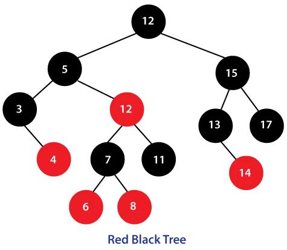
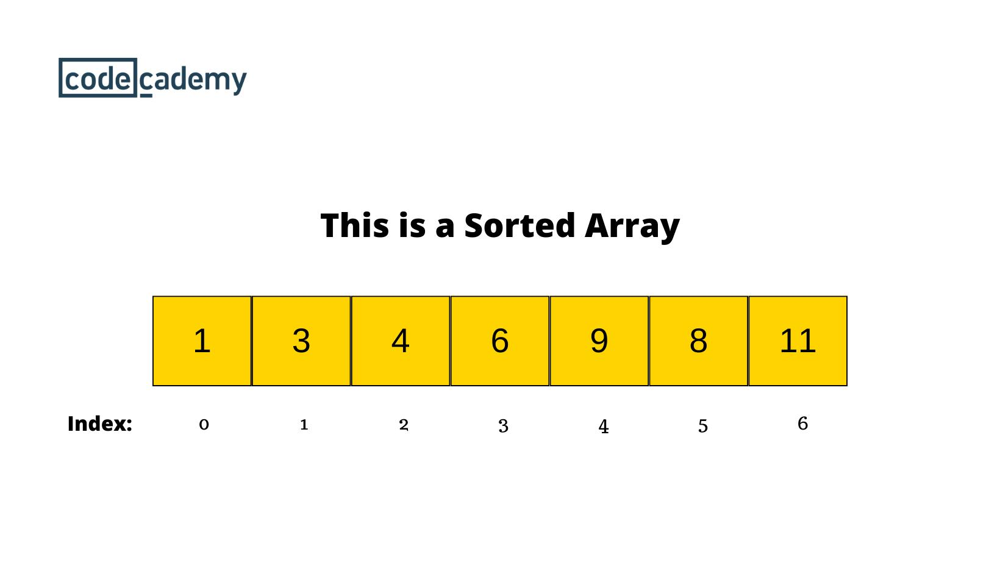

<div align="center">

[🇺🇸 English](./flat_set.md) | [🇮🇷 فارسی](../../fa/cpp23/flat_set.md)

</div>

# std::flat_set

`std::flat_set` is a new container introduced in C++23. It is designed to store a collection of **sorted, unique elements**.

**Important:** `std::flat_set` is defined in the `<flat_set>` header.

##  Defining a flat_set

```cpp
#include <iostream>
#include <flat_set>

int main() {
    std::flat_set<int> numbers{
        5, 2, 8, 2, 1, 5, 3
    };

    for (const auto& n : numbers) {
        std::cout << n << ' ';
    }
}
```

**Output:**

```txt
1 2 3 5 8
```

Three important characteristics:

- Elements are always sorted.
- Duplicate elements are not allowed.
- Searching has logarithmic time complexity.

##  Difference Between flat_set and set

Both containers store sorted and unique elements, but their internal data structures are different.

**std::set**




Usually implemented using a balanced binary search tree.

**std::flat_set**




Based on sorted, contiguous storage.

| Feature         | `std::set`     | `std::flat_set` |
| --------------- | -------------- | --------------- |
| Sorted elements | Yes            | Yes             |
| Unique elements | Yes            | Yes             |
| Search          | O(log N)       | O(log N)        |
| Insertion       | O(log N)       | O(N)            |
| Erasure         | O(log N)       | O(N)            |
| Memory usage    | Usually higher | Usually lower   |

##  Common flat_set Operations

**Inserting elements**

```cpp
std::flat_set<int> s;

s.insert(10);
s.insert(20);
s.insert(5);
s.insert(10);
```

**Checking whether an element exists (contains)**

```cpp
if (s.contains(10)) {
    std::cout << "Found!";
}
```

**Removing an element (erase)**

```cpp
s.erase(20);
```

**Searching for an element (find)**

```cpp
auto it = s.find(10);

if (it != s.end()) {
    std::cout << *it;
}
```

##  Using flat_set with Custom Data Types

For example, suppose we want to store users and sort them by ID.

```cpp
#include <iostream>
#include <string>
#include <flat_set>

struct User {
    int id;
    std::string name;
};

struct Compare {
    bool operator()(const User& a,
                    const User& b) const {
        return a.id < b.id;
    }
};

int main() {
    std::flat_set<User, Compare> users;

    users.insert({3, "Ali"});
    users.insert({1, "Reza"});
    users.insert({2, "Sara"});
    users.insert({1, "Mohammad"});

    for (const auto& user : users) {
        std::cout << user.id << " "
                  << user.name << '\n';
    }
}
```

**Output:**

```txt
1 Reza
2 Sara
3 Ali
```

Why wasn't Mohammad inserted?

Because the comparison function considers only the ID. Therefore, two users with the same ID are considered equivalent, even if their names are different.

##  When Should You Use flat_set?

Consider using `std::flat_set` when:

- The number of elements is relatively stable.
- Searching operations are frequent.
- Insertions and deletions are relatively infrequent.
- Memory locality and cache performance are important.
- You want sorted data stored contiguously in memory.


## Important Note

To compile these examples, your compiler and standard library implementation must support `std::flat_set`.

Simply enabling the C++23 language standard (for example, using `-std=c++23`) does not guarantee that `std::flat_set` is available.

You can check library support using:

```
#ifdef __cpp_lib_flat_set
    // std::flat_set is supported
#endif
```

**Key takeaway:** `std::flat_set` is a sorted associative container with unique elements and contiguous storage by default. It can provide efficient searching and cache-friendly iteration, but insertions and deletions are generally more expensive than in `std::set`.

---

## 🤝 Contributors
<div align="center">

| GitHub | LinkedIn | Email | Site | Telegram |
|--------|----------|-------|------|----------|
| [mbr](https://github.com/mbr1376) | [mbr](https://www.linkedin.com/in/mbr1376/) | [mbr](m.roodsarabi76@gmail.com) | | [mbr](@ad1mi2n) |

</div>