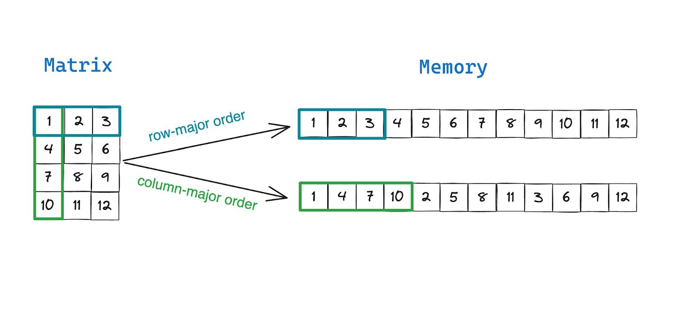
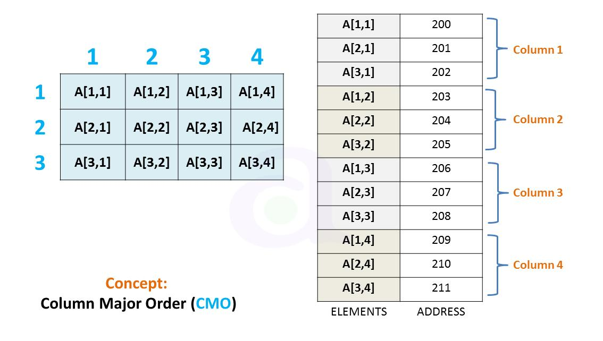

<div align="center">

[🇺🇸 English](./mdspan.md) | [🇮🇷 فارسی](../../fa/cpp23/mdspan.md)

</div>

#  std::mdspan
`std::mdspan` is one of the most interesting features introduced in C++23. It is designed to work with multidimensional arrays.

Using `std::mdspan`, you can create a multidimensional view over existing memory without allocating new memory for the underlying data.

Introduced in C++23

##  Why Do We Need mdspan?

Suppose we have a 3×4 matrix:

```cpp
int matrix[3][4] = {
    {1, 2, 3, 4},
    {5, 6, 7, 8},
    {9, 10, 11, 12}
};
```

To access the element in the second row and third column, we write:

```cpp
matrix[1][2];
```

But what if the data is stored in a one-dimensional array?

```cpp
int data[12] = {
    1, 2, 3, 4,
    5, 6, 7, 8,
    9, 10, 11, 12
};
```

To access the desired element, we need to calculate its index manually:

```cpp
data[1 * 4 + 2];
```

This is where `std::mdspan` becomes useful.

##  Your First Program with mdspan

Required header:

```cpp
#include <mdspan>
```

Complete example:

```cpp
#include <iostream>
#include <mdspan>

int main()
{
    int data[12] = {
        1, 2, 3, 4,
        5, 6, 7, 8,
        9, 10, 11, 12
    };

    std::mdspan<int, std::extents<3, 4>>
        matrix(data);

    std::cout << matrix[1, 2] << '\n';

    matrix[1, 2] = 100;

    std::cout << matrix[1, 2] << '\n';
}
```

**Output:**

```txt
7
100
```

Notice this syntax:

```cpp
matrix[1, 2]
```

C++23 supports multidimensional indexing through the multi-argument subscript operator.

##  Understanding Non-owning Views

One of the most important characteristics of `mdspan` is that it does not own the memory.

This means:

- It does not allocate memory for the underlying elements.
- It does not deallocate the underlying memory.
- It creates a view over existing memory.
- Changes made through `mdspan` affect the original data.

Example:

```cpp
int data[4] = {10, 20, 30, 40};

std::mdspan<int, std::extents<4>> view(data);

view[2] = 999;

std::cout << data[2];
```

**Output:**

```txt
999
```


##  Understanding std::extents

`std::extents` defines the dimensions of a multidimensional array.

For example:

```cpp
std::extents<3, 4>
```

Represents a matrix with:

- 3 rows
- 4 columns

Example:

```cpp
int data[12]{};

std::mdspan<int, std::extents<3, 4>> matrix(data);
```

### Static Extents

Dimensions are known at compile time:

```cpp
using Extents = std::extents<3, 4>;

std::mdspan<int, Extents> matrix(data);
```

### Dynamic Extents

Dimensions are determined at runtime:

```cpp
int data[12]{};

using Extents =
    std::dextents<std::size_t, 2>;

std::mdspan<int, Extents> matrix(
    data, 3, 4
);
```

In this example, the number of rows and columns is specified at runtime.

##  Working with Two-Dimensional Matrices

```cpp
#include <iostream>
#include <mdspan>

int main()
{
    int data[12]{};

    std::mdspan<int, std::extents<3, 4>>
        matrix(data);

    for (std::size_t row = 0; row < 3; ++row)
    {
        for (std::size_t col = 0; col < 4; ++col)
        {
            matrix[row, col] = row * 10 + col;
        }
    }

    for (std::size_t row = 0; row < 3; ++row)
    {
        for (std::size_t col = 0; col < 4; ++col)
        {
            std::cout << matrix[row, col] << ' ';
        }

        std::cout << '\n';
    }
}
```

**Output:**

```txt
0 1 2 3
10 11 12 13
20 21 22 23
```

##  Understanding Layouts

One of the most important aspects of `mdspan` is how elements are arranged in memory.

C++23 provides three important layout policies:

### LayoutRight

In this layout, the last dimension varies fastest.

```cpp
std::mdspan<
    int,
    std::extents<3, 4>,
    std::layout_right
> matrix(data);
```

This is similar to Row-major storage.




### LayoutLeft

In this layout, the first dimension varies fastest.

```
std::mdspan<
    int,
    std::extents<3, 4>,
    std::layout_left
> matrix(data);
```

This is similar to Column-major storage.




### LayoutStride

This layout allows you to specify the stride between elements in each dimension.

```cpp
#include <array>
#include <mdspan>

std::mdspan<
    int,
    std::dextents<std::size_t, 2>,
    std::layout_stride
> matrix(
    data,
    std::layout_stride::mapping(
        std::dextents<std::size_t, 2>(3, 4),
        std::array<std::size_t, 2>{6, 1}
    )
);
```

This is useful when elements are not stored with the default contiguous layout.

##  Using mdspan with std::vector

One important application of `mdspan` is working with dynamically allocated memory.

```cpp
#include <iostream>
#include <vector>
#include <mdspan>

int main()
{
    std::vector<int> data(12);

    using Extents = std::dextents<std::size_t, 2>;

    std::mdspan<int, Extents> matrix(
        data.data(), 3, 4
    );

    matrix[1, 2] = 500;

    std::cout << data[6];
}
```

**Output:**

```txt
500
```

Remember:

- `std::vector` owns the memory.
- `std::mdspan` provides a view over that memory.

If an operation on the vector reallocates its storage, the previous `mdspan` may become invalid.

##  Difference Between mdspan, vector, and array

| Feature                 | vector           | array              | mdspan                        |
| ----------------------- | ---------------- | ------------------ | ----------------------------- |
| Owns memory             | Yes              | Yes                | No                            |
| Dynamic memory          | Yes              | No                 | Depends on underlying storage |
| Multidimensional access | No, not directly | With nested arrays | Yes                           |
| Dynamic dimensions      | Yes, in size     | No                 | Yes                           |
| Custom memory layout    | No               | No                 | Yes                           |

##  Important Performance Considerations

`mdspan` does not copy the underlying data. It provides a multidimensional access interface over existing memory.

Important advantages:

- No additional allocation for the view itself.
- No data copying.
- Multidimensional indexing.
- Ability to choose an appropriate layout for cache locality.
- Suitable for scientific computing and matrix operations.

## Final Notes

`std::mdspan` was introduced in C++23, while `std::submdspan` belongs to C++26.

Actual support depends on the compiler and its standard library implementation.

**My recommendation for the next step:** Study `std::extents` in depth, especially the differences between Static and Dynamic Extents. These concepts are fundamental to understanding `mdspan`.

--- 
## 🤝 مشارکت کنندگان

<div align="center">

| GitHub | LinkedIn | Email | Site | Telegram |
|--------|----------|-------|------|----------|
| [mbr](https://github.com/mbr1376) | [mbr](https://www.linkedin.com/in/mbr1376/) | [mbr](m.roodsarabi76@gmail.com) | | [mbr](https://t.me/ad1mi2n) |

</div>