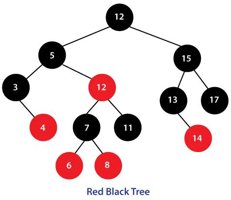
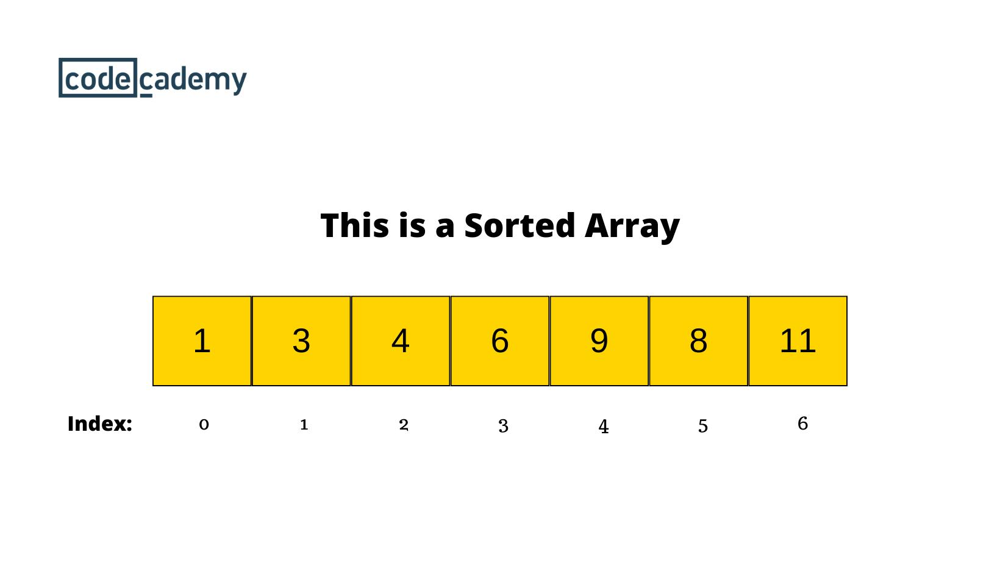

<div align="center">

[🇺🇸 English](../../en/cpp23/flat_set.md) | [🇮🇷 فارسی](./flat_set.md)

</div>

# flat_set

`std::flat_set` یکی از کانتینرهای جدید C++23 است که برای نگهداری مجموعه‌ای از عناصر **مرتب و بدون تکرار** استفاده می‌شود.

نکته مهم: `std::flat_set` در هدر `<flat_set>` قرار دارد.

##  تعریف flat_set

```cpp
#include <iostream>
#include <flat_set>

int main() {
    std::flat_set<int> numbers{
        5, 2, 8, 2, 1, 5, 3
    };

    for (const auto& n : numbers) {
        std::cout << n << ' ';
    }
}
```

**Output**

```text
1 2 3 5 8
```

سه ویژگی مهم:

- عناصر همیشه مرتب هستند.
- عناصر تکراری حذف می‌شوند.
- جستجو با پیچیدگی لگاریتمی انجام می‌شود.

##  تفاوت flat_set با set

هر دو عناصر مرتب و یکتا نگهداری می‌کنند، اما ساختار داخلی متفاوتی دارند.

**std::set**



معمولاً مبتنی بر درخت متوازن است.

**std::flat_set**



بر پایه ذخیره‌سازی مرتب و پیوسته است.

| ویژگی      | `std::set`    | `std::flat_set` |
| ---------- | ------------- | --------------- |
| مرتب‌سازی  | بله           | بله             |
| عناصر یکتا | بله           | بله             |
| جستجو      | O(log N)      | O(log N)        |
| درج        | O(log N)      | O(N)            |
| حذف        | O(log N)      | O(N)            |
| حافظه      | معمولاً بیشتر | معمولاً کمتر    |

##  عملیات مهم flat_set

**درج عنصر (insert)**

```cpp
std::flat_set<int> s;

s.insert(10);
s.insert(20);
s.insert(5);
s.insert(10);
```

**جستجو (contains)**

```cpp
if (s.contains(10)) {
    std::cout << "Found!";
}
```

**حذف (erase)**

```cpp
s.erase(20);
```

**جستجو با find**

```cpp
auto it = s.find(10);

if (it != s.end()) {
    std::cout << *it;
}
```

##  استفاده از flat_set با داده‌های سفارشی

مثلاً می‌خواهیم کاربران را بر اساس ID مرتب کنیم:

```cpp
#include <iostream>
#include <flat_set>

struct User {
    int id;
    std::string name;
};

struct Compare {
    bool operator()(const User& a,
                    const User& b) const {
        return a.id < b.id;
    }
};

int main() {
    std::flat_set<User, Compare> users;

    users.insert({3, "Ali"});
    users.insert({1, "Reza"});
    users.insert({2, "Sara"});
    users.insert({1, "Mohammad"});

    for (const auto& user : users) {
        std::cout << user.id << " "
                  << user.name << '\n';
    }
}
```

**خروجی:**

```text
1 Reza
2 Sara
3 Ali
```

چون مقایسه فقط بر اساس ID است، کاربر دوم با ID برابر 1 وارد مجموعه نمی‌شود.

##  چه زمانی از flat_set استفاده کنیم؟

- وقتی تعداد عناصر نسبتاً ثابت است.
- وقتی عملیات جستجو زیاد داریم.
- وقتی درج و حذف مکرر نداریم.
- وقتی locality حافظه و cache performance مهم است.


**نکته:** برای کامپایل، باید کامپایلر و کتابخانه استانداردت از `std::flat_set` پشتیبانی کنند؛ صرفاً فعال‌کردن `-std=c++23` کافی نیست.

--- 
## 🤝 مشارکت کنندگان

<div align="center">

| GitHub | LinkedIn | Email | Site | Telegram |
|--------|----------|-------|------|----------|
| [mbr](https://github.com/mbr1376) | [mbr](https://www.linkedin.com/in/mbr1376/) | [mbr](m.roodsarabi76@gmail.com) | | [mbr](https://t.me/ad1mi2n) |

</div>