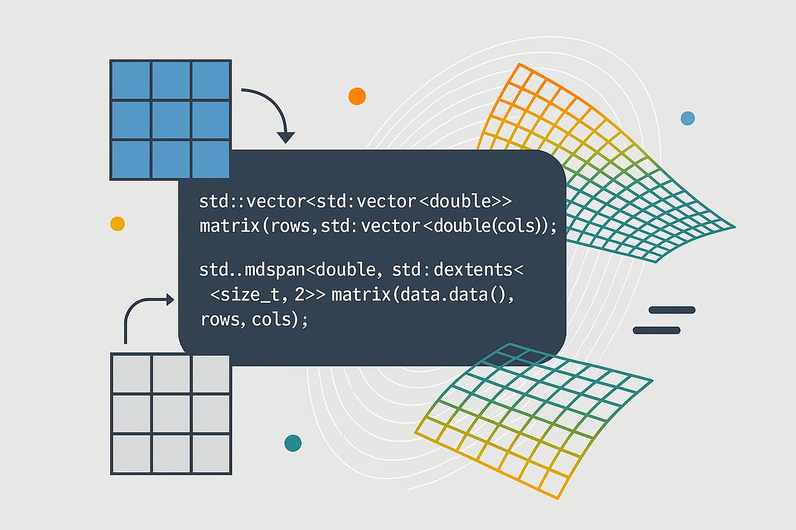
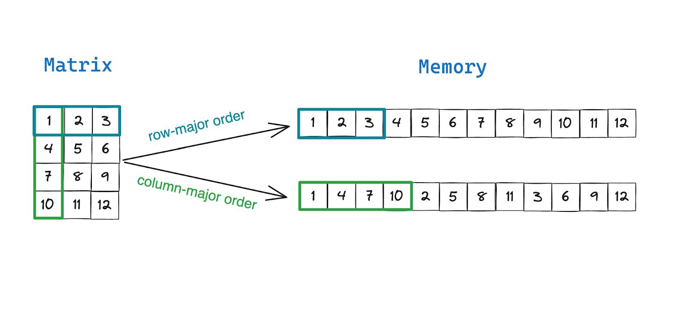
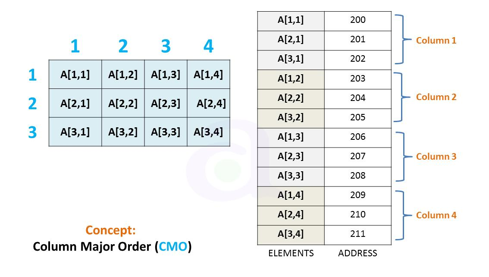

<div align="center">

[🇺🇸 English](../../en/cpp23/flat_set.md) | [🇮🇷 فارسی](./flat_set.md)

</div>

#  std::mdspan

`std::mdspan` یکی از قابلیت‌های جذاب C++23 است که برای کار با آرایه‌های چندبعدی (Multidimensional Arrays) طراحی شده است.

با استفاده از `mdspan` می‌توانیم روی حافظه‌ای که از قبل وجود دارد، یک View چندبعدی ایجاد کنیم؛ بدون اینکه حافظه جدیدی برای داده‌ها تخصیص دهیم.


##  چرا به mdspan نیاز داریم؟

فرض کن یک ماتریس 3×4 داریم:

```cpp
int matrix[3][4] = {
    {1, 2, 3, 4},
    {5, 6, 7, 8},
    {9, 10, 11, 12}
};
```

برای دسترسی به عنصر سطر دوم و ستون سوم می‌نویسیم:

```cpp
matrix[1][2];
```

اما اگر داده‌ها به‌صورت یک آرایه یک‌بعدی ذخیره شده باشند چه؟

```cpp
int data[12] = {
    1, 2, 3, 4,
    5, 6, 7, 8,
    9, 10, 11, 12
};
```

برای دسترسی به عنصر موردنظر باید خودمان محاسبه کنیم:

```cpp
data[1 * 4 + 2];
```

اینجاست که `std::mdspan` به کمک ما می‌آید.

##  اولین برنامه با mdspan

هدر موردنیاز:

```cpp
#include <mdspan>
```

مثال کامل:

```cpp
#include <iostream>
#include <mdspan>

int main()
{
    int data[12] = {
        1, 2, 3, 4,
        5, 6, 7, 8,
        9, 10, 11, 12
    };

    std::mdspan<int, std::extents<3, 4>>
        matrix(data);

    std::cout << matrix[1, 2] << '\n';

    matrix[1, 2] = 100;

    std::cout << matrix[1, 2] << '\n';
}
```

خروجی:

```cpp
7
100
```

**دقت کن:**

```cpp
matrix[1, 2]
```

در C++23 از قابلیت چندآرگومانی `operator[]` استفاده می‌کند.

##  مفهوم Non-owning View**

یکی از مهم‌ترین ویژگی‌های `mdspan` این است که مالک حافظه نیست.

**یعنی:**

- حافظه را خودش تخصیص نمی‌دهد.
- حافظه را آزاد نمی‌کند.
- فقط روی حافظه موجود View ایجاد می‌کند.
- تغییر داده‌ها از طریق mdspan روی حافظه اصلی اعمال می‌شود.

مثال:

```cpp
int data[4] = {10, 20, 30, 40};

std::mdspan<int, std::extents<4>> view(data);

view[2] = 999;

std::cout << data[2];
```

**خروجی:**

```
999
```




##  آشنایی با std::extents

`std::extents` ابعاد ماتریس را مشخص می‌کند.

مثلاً:

```cpp
std::extents<3, 4>
```

یعنی ماتریسی با:

- 3 سطر
- 4 ستون

مثال:

```cpp
int data[12]{};

std::mdspan<int, std::extents<3, 4>> matrix(data);
```

### Static Extents

ابعاد در زمان کامپایل مشخص هستند:

```cpp
using Extents = std::extents<3, 4>;

std::mdspan<int, Extents> matrix(data);
```

### Dynamic Extents

ابعاد در زمان اجرا مشخص می‌شوند:

```cpp
int data[12]{};

using Extents =
    std::dextents<std::size_t, 2>;

std::mdspan<int, Extents> matrix(
    data, 3, 4
);
```

در این مثال تعداد سطرها و ستون‌ها در زمان اجرا تعیین می‌شود.

## **5. کار با ماتریس‌های دوبعدی**

```cpp
#include <iostream>
#include <mdspan>

int main()
{
    int data[12]{};

    std::mdspan<int, std::extents<3, 4>>
        matrix(data);

    for (std::size_t row = 0; row < 3; ++row)
    {
        for (std::size_t col = 0; col < 4; ++col)
        {
            matrix[row, col] = row * 10 + col;
        }
    }

    for (std::size_t row = 0; row < 3; ++row)
    {
        for (std::size_t col = 0; col < 4; ++col)
        {
            std::cout << matrix[row, col] << ' ';
        }

        std::cout << '\n';
    }
}
```

خروجی:

```txt
0 1 2 3
10 11 12 13
20 21 22 23
```

##  آشنایی با Layoutها

یکی از مهم‌ترین قسمت‌های `mdspan` نحوه چیدمان داده‌ها در حافظه است.

C++23 سه Layout مهم دارد:

### LayoutRight

در این حالت آخرین بُعد سریع‌تر تغییر می‌کند.

```cpp
std::mdspan<
    int,
    std::extents<3, 4>,
    std::layout_right
> matrix(data);
```

این روش مشابه Row-major است.




### LayoutLeft

در این حالت اولین بُعد سریع‌تر تغییر می‌کند.

```cpp
std::mdspan<
    int,
    std::extents<3, 4>,
    std::layout_left
> matrix(data);
```

این روش مشابه Column-major است.




### LayoutStride

در این روش می‌توان فاصله بین عناصر هر بُعد را مشخص کرد.

```cpp
std::mdspan<
    int,
    std::dextents<std::size_t, 2>,
    std::layout_stride
> matrix(
    data,
    std::layout_stride::mapping(
        std::dextents<std::size_t, 2>(3, 4),
        std::array<std::size_t, 2>{6, 1}
    )
);
```

این روش برای داده‌هایی که فاصله عناصر آن‌ها در حافظه یکنواخت نیست، مفید است.

## استفاده از mdspan با std::vector

یکی از کاربردهای مهم mdspan کار با حافظه پویا است.

```cpp
#include <iostream>
#include <vector>
#include <mdspan>

int main()
{
    std::vector<int> data(12);

    using Extents = std::dextents<std::size_t, 2>;

    std::mdspan<int, Extents> matrix(
        data.data(), 3, 4
    );

    matrix[1, 2] = 500;

    std::cout << data[6];
}
```

خروجی:

```txt
500
```

دقت کن که `vector` مالک حافظه است و `mdspan` فقط View آن است. اگر عملیات روی vector باعث جابه‌جایی حافظه شود، View قبلی ممکن است نامعتبر شود.

##  تفاوت mdspan با vector و array

| ویژگی          | vector | array             | mdspan                   |
| -------------- | ------ | ----------------- | ------------------------ |
| مالک حافظه     | بله    | بله               | خیر                      |
| حافظه پویا     | بله    | خیر               | به حافظه اصلی وابسته است |
| دسترسی چندبعدی | خیر    | با آرایه تو در تو | بله                      |
| ابعاد پویا     | بله    | خیر               | بله                      |
| Layout سفارشی  | خیر    | خیر               | بله                      |

##  نکات مهم Performance

`mdspan` خودش داده‌ها را کپی نمی‌کند و یک لایه دسترسی چندبعدی فراهم می‌کند.

مزایای مهم:

- عدم تخصیص حافظه اضافی برای View
- عدم کپی داده‌ها
- دسترسی چندبعدی با اندیس‌گذاری استاندارد
- امکان انتخاب Layout مناسب برای Cache Locality
- مناسب برای محاسبات علمی و ماتریسی

--- 
## 🤝 مشارکت کنندگان

<div align="center">

| GitHub | LinkedIn | Email | Site | Telegram |
|--------|----------|-------|------|----------|
| [mbr](https://github.com/mbr1376) | [mbr](https://www.linkedin.com/in/mbr1376/) | [mbr](m.roodsarabi76@gmail.com) | | [mbr](https://t.me/ad1mi2n) |

</div>